# NexusERP: An Edge-First, Self-Learning ERP and Automated Multi-Model Demand Forecasting System for SME Retail

## Comprehensive Academic Project Report & Master Reference

---

### Academic Metadata & Project Identity

- **Project Title:** NexusERP: An AI Lightweight ERP and Demand Forecasting System for SME Retail
- **Student Name:** Albin Joseph
- **Register Number:** AJC23CS027
- **Degree:** Bachelor of Technology (B.Tech) in Computer Science and Engineering
- **Institution:** Amal Jyothi College of Engineering (Autonomous), Kanjirappally, Kerala
- **Affiliated University:** APJ Abdul Kalam Technological University (KTU), Kerala
- **Internal Guide:** Dr. Jacob John, Associate Professor, Department of Computer Science and Engineering
- **Head of Department:** Dr. Juby Mathew, Professor & HOD, Department of Computer Science and Engineering
- **Academic Year / Date:** 2025–2026 / October 2026
- **Repository Reference:** `Albin28/Final-Year-Project` (NexusERP Production Core)

---

## Executive Abstract

Small and medium-sized enterprise (SME) retailers in fast-moving consumer goods (FMCG) sectors operate on razor-thin net profit margins, typically between 2% and 5%. Within this operational environment, inventory misallocation represents the single largest threat to working capital: overstocking incurs carrying costs of 20% to 35% annually alongside inventory perishability write-offs, while stockouts result in direct revenue forfeiture and permanent customer defection. Commercial enterprise resource planning (ERP) platforms (such as SAP S/4HANA and Oracle NetSuite) fail to address SME needs due to prohibitive multi-thousand-dollar licensing costs, mandatory high-bandwidth cloud dependencies, and complex parameterization requiring dedicated data science specialists.

This project delivers **NexusERP**, an edge-first, autonomous retail management and predictive inventory replenishment system engineered specifically for commodity hardware in independent retail environments. NexusERP couples an atomic Point of Sale (POS) transactional engine with a mathematical demand classification pipeline, an automated multi-model machine learning tournament, and a scientific $(s, S)$ periodic replenishment framework. Historical point-of-sale transactions are ingested into an ACID-compliant local SQLite relational database. The system executes the Syntetos-Boylan Classification (SBC) using Average Demand Interval ($ADI$) and Squared Coefficient of Variation ($CV^2$) to segment stock-keeping units (SKUs) into Regular, Erratic, Intermittent, and Lumpy quadrants. This mathematical clustering prunes candidate algorithm search spaces, dispatching an automated tournament pitting Facebook Prophet, Holt-Winters Exponential Smoothing, Scikit-Learn Random Forest Regressors, Gradient Boosting Regressors, and Simple Exponential Smoothing (SES) over out-of-sample holdout test splits to select the minimum Mean Absolute Error (MAE) model per SKU. Forecast trajectories are converted into dynamic Safety Stock ($SS$), Reorder Point ($ROP$), and Target Inventory ($TI$) replenishment orders under Gaussian service-level guarantees ($Z = 1.65$ at 95% service level). Benchmarked on a canonical 2-year retail dataset comprising 54,780 daily records across 30 grocery SKUs, NexusERP executes full-catalog retraining in 13.29 seconds, reduces forecast error by 18.4% over static single-model baselines, and serves interactive frontend predictions in sub-50-millisecond cached latency without cloud reliance.

**Keywords:** Enterprise Resource Planning, Demand Forecasting, Automated Model Tournament, Syntetos-Boylan Classification, $(s, S)$ Periodic Replenishment, Explainable AI, Edge Computing, Point of Sale Architecture.

---

## 1. Introduction & Operational Scope

### 1.1 Problem Formulation & Industry Motivation
Small and Medium-sized Enterprises (SMEs), including independent grocery stores, neighborhood supermarkets, and local retail distributors, represent the commercial backbone of regional retail economies. Unlike multinational hypermarkets supported by centralized analytics teams and dedicated server clusters, retail SMEs operate on precarious net margins (2% to 5%). Under such conditions, profitability depends almost entirely on the precision of inventory working capital allocation.

Traditional store managers are confronted with two diametrically opposed failure modes:
1. **The Overstocking Penalty:** Over-purchasing binds critical liquidity, incurring annual holding costs approximating 20% to 35% of inventory valuation due to physical warehousing limitations, capital interest, obsolescence, and physical perishability of dairy, bakery, and produce lines.
2. **The Stockout Penalty:** Under-purchasing leads to immediate lost sales, supplier backorder penalties, and customer churn, as consumers routinely defect to competing merchants when staple groceries are depleted.

Small retail merchants historically address this trade-off through manual paper ledgers, subjective intuition, or basic electronic cash registers. When merchants explore commercial software, they encounter enterprise ERP systems built for large corporations. These solutions mandate uninterrupted cloud bandwidth, charge recurring Software-as-a-Service (SaaS) subscription fees, and lack embedded time-series intelligence capable of autonomously adjusting to localized sales variance. Consequently, there is an acute need for a lightweight, edge-first ERP platform that operates completely offline, autonomously forecasts multi-horizon item demand, and derives actionable restocking orders.

### 1.2 System Objectives & Design Goals
NexusERP was engineered from first principles to fulfill the following objectives:
1. **Offline-First Multi-Tier Architecture:** Build a decoupled, high-performance local ERP runtime using FastAPI (Python 3.11+), React 19, and an ACID-compliant embedded SQLite database capable of executing 100% of operations without internet connectivity.
2. **Mathematical Demand Classification:** Integrate the Syntetos-Boylan Classification (SBC) framework using Average Demand Interval ($ADI$) and Squared Coefficient of Variation ($CV^2$) to partition product catalogs into Regular, Erratic, Intermittent, and Lumpy quadrants.
3. **Automated Multi-Model Forecasting Tournament:** Construct an automated competition engine that trains candidate models (Facebook Prophet, Holt-Winters Exponential Smoothing, Random Forest, Gradient Boosting, and Simple Exponential Smoothing) over chronological holdout splits, selecting the model with the lowest out-of-sample MAE per item.
4. **Scientific Periodic $(s, S)$ Replenishment:** Derive dynamic Safety Stock ($SS$), Reorder Points ($ROP$), and Target Inventory ($TI$) levels governed by Gaussian service-level confidence intervals ($Z = 1.65$), providing managers with deterministic restocking recommendations.
5. **Atomic POS Core & Procurement Lifecycle:** Deliver high-throughput POS checkout with live shelf-stock validation, atomic inventory decrementing, 80mm ESC/POS thermal receipt formatting, and an end-to-end 4-stage Purchase Order (PO) procurement pipeline (`Generated` $\rightarrow$ `Approved` $\rightarrow$ `Pending Delivery` $\rightarrow$ `Delivered`).

### 1.3 Implementation Scope & Boundaries
- **In-Scope:** Full local transactional processing across POS, Inventory, and Purchase Orders; historical transaction ingestion and automated model competition over 30 canonical retail SKUs; executive dashboard analytics including ABC-XYZ portfolio segmentation and interactive SVG forecast charts; persistent disk caching of model forecasts for sub-50ms query response.
- **Boundaries / Deferred to Phase II:** Multi-store distributed database synchronization across wide-area networks; automated banking Electronic Data Interchange (EDI); direct proprietary binary receipt printer device drivers (printing is handled via standard browser ESC/POS thermal formatting).

---

## 2. Comprehensive Literature Survey

### 2.1 Silva et al. (2026): Multi-Model Demand Forecasting and Categorization in Energy Sector Inventory
- **Citation:** L. F. da Silva, E. da Silva Christo, K. A. Costa, and H. P. Tavares, "Combining demand classification and forecasting models in spare parts inventory management for the energy sector," *The International Journal of Advanced Manufacturing Technology*, vol. 144, no. 7, pp. 355–366, 2026. DOI: `10.1007/s00170-026-17483-1`.
- **Core Methodology:** Investigated inventory optimization across 2,244 items in an energy utility company in southeastern Brazil. The authors integrated a dual classification framework: Syntetos-Boylan demand categorization (dividing series into Irregular, Intermittent, Erratic, and Regular based on $ADI$ and $CV^2$) combined with ABC monetary value segmentation. They evaluated five predictive algorithms: Random Forest, XGBoost, Holt, Holt-Winters, and SARIMA across 13,464 model iterations using the CRITIC (Criteria Importance Through Intercriteria Correlation) multi-criteria evaluation method.
- **Key Findings:** Empirical results showed that no single forecasting model dominates across all inventory profiles. Random Forest achieved the highest forecast accuracy for irregular and intermittent demand series, while Holt-Winters achieved superior performance on regular items exhibiting defined seasonal trend patterns.
- **Limitations & Architectural Gap:** The study was executed as an offline research analysis within a Python/Spyder data science environment without integrating a operational ERP transactional database, Point of Sale checkout engine, or automated restocking loop. NexusERP operationalizes this classification-competition paradigm within an edge runtime.

### 2.2 Goulart et al. (2026): Machine Learning Demand Forecasting for Inventory Optimization at an SME Distributor
- **Citation:** D. D. Goulart, R. B. de Carvalho, M. A. Henriques, and B. K. G. N. Carvalho, "Predictive models for inventory optimization: a machine learning application for demand forecasting at a construction supplies distributor," *Future Business Journal*, vol. 12, no. 1, art. 92, 2026. DOI: `10.1186/s43093-026-00807-8`.
- **Core Methodology:** Implemented an enterprise predictive analytics framework for a medium-sized Brazilian construction materials distributor. The authors evaluated cloud-based AutoML platforms (Amazon Forecast and Amazon SageMaker Canvas) across an 80/20 train-test temporal split with a 60-day forecast horizon. Model accuracy was assessed via Weighted Absolute Percentage Error (WAPE), Root Mean Squared Error (RMSE), and Mean Absolute Scaled Error (MASE).
- **Key Findings:** The automated predictive pipeline achieved an aggregate WAPE of 0.69%, significantly outperforming retrospective descriptive spreadsheets and manual manager intuition. The study emphasized the organizational value of AutoML for SMEs lacking in-house data science teams.
- **Limitations & Architectural Gap:** The solution relies entirely on proprietary cloud infrastructure (AWS SageMaker Canvas), incurring ongoing cloud subscription costs and requiring persistent high-speed internet connectivity. NexusERP eliminates this cloud tether by hosting the entire multi-model tournament engine locally on edge hardware.

### 2.3 Basavaraju et al. (2025): Demand Planning Strategy and Analytical Tool Integration for Supply Chain Forecasting
- **Citation:** K. Basavaraju and O. F. Valilai, "Developing a demand planning strategy for joint forecasting and employing analytical tool in an empirical case study," *Discover Applied Sciences*, vol. 7, no. 4, art. 345, 2025. DOI: `10.1007/s42452-025-06740-9`.
- **Core Methodology:** Developed an end-to-end demand planning framework integrating legacy ERP transactional systems, JDA software, and customer order signals. Tested within a manufacturing and distribution supply chain, the methodology investigated the alignment of forecasting time fences, demand horizons, and cross-departmental communication protocols.
- **Key Findings:** Demonstrates that joint integration between transactional sales ledgers and statistical demand planning models reduces inventory stockouts and bullwhip distortions by aligning procurement schedules directly with dynamic replenishment thresholds.
- **Limitations & Architectural Gap:** Focused on enterprise-tier IT landscapes characterized by complex middleware integrations between heavyweight commercial suites (JDA, SAP). It lacks a lightweight, unified architecture suitable for independent SME retailers operating on single-node computers. NexusERP bridges this gap by unifying transactional POS and predictive demand planning in a single local application.

### 2.4 Douaioui et al. (2024): Critical Review of Machine Learning and Deep Learning Models for Demand Forecasting
- **Citation:** K. Douaioui, R. Oucheikh, O. Benmoussa, and C. Mabrouki, "Machine Learning and Deep Learning Models for Demand Forecasting in Supply Chain Management: A Critical Review," *Applied System Innovation*, vol. 7, no. 5, art. 93, 2024. DOI: `10.3390/asi7050093`.
- **Core Methodology:** Conducted a comprehensive survey analyzing over a decade of research in machine learning (Random Forest, Gradient Boosting, Support Vector Machines) and deep learning architectures (LSTM, GRU, Temporal Fusion Transformers) applied to supply chain demand prediction.
- **Key Findings:** Concluded that while deep learning networks capture complex non-linear temporal relationships in high-dimensional corporate datasets, ensemble decision trees (Random Forest, Gradient Boosting) consistently deliver superior empirical accuracy and operational robustness on tabular retail time series. Tree ensembles require significantly less computational overhead, converge faster, and provide interpretable feature importances.
- **Limitations & Architectural Gap:** Emphasized the persistent disconnect between academic literature and operational supply chain software: predictive models are rarely integrated into accessible operational tools with automated reorder mechanisms. NexusERP directly addresses this critique by embedding tree ensembles and classical statistical models into an operational ERP interface.

### 2.5 Foundational Theoretical References
- **Syntetos & Boylan (2005):** Formalized the mathematical cutoffs ($ADI = 1.32, CV^2 = 0.49$) categorizing intermittent and erratic demand profiles, establishing the mathematical basis for avoiding continuous smoothing misapplication on intermittent items (*Int. J. Forecasting*, 21(2), 303–314).
- **Taylor & Letham (2018):** Introduced Facebook Prophet, formulating a Generalized Additive Model (GAM) incorporating piecewise linear trends, Fourier seasonality, and holiday regressors (*The American Statistician*, 72(1), 37–45).
- **Silver, Pyke, & Peterson (1998):** Established the continuous review $(s, Q)$ and periodic review $(s, S)$ inventory control frameworks governing safety stock derivation under Gaussian lead-time variance (*Inventory Management and Production Planning and Scheduling*, 3rd ed., Wiley).
- **Croston (1972):** Proved that exponential smoothing yields biased estimates on intermittent demand and introduced separate estimation of transaction intervals and sizes (*J. Operational Research Society*, 23(3), 289–303).

### 2.6 Comparative Literature Summary Matrix

| Research Dimension | Silva et al. (2026) | Goulart et al. (2026) | Basavaraju et al. (2025) | Douaioui et al. (2024) | **NexusERP (Proposed)** |
| :--- | :--- | :--- | :--- | :--- | :--- |
| **Target Sector** | Energy utility spare parts | Construction materials distributor | Manufacturing & distribution | General supply chain review | **SME Retail & Grocery (FMCG)** |
| **Forecasting Methodologies** | Random Forest, XGBoost, Holt, Holt-Winters, SARIMA | Cloud AutoML (Amazon Forecast, SageMaker Canvas) | Statistical time-series + Customer joint signals | Machine Learning & Deep Learning survey | **Multi-Model Tournament: Prophet, HW, RF, GB, SES** |
| **Demand Categorization** | Syntetos-Boylan (4 categories) + ABC | Aggregate SKU analysis | Customer order profile segmentation | Algorithmic taxonomy | **Syntetos-Boylan ($ADI, CV^2$) + ABC-XYZ Portfolio** |
| **Inventory Replenishment** | Multi-criteria inventory scoring | Reorder policy simulation | ERP replenishment schedules | Theoretical review | **Scientific Periodic $(s, S)$ ROP & Target Inventory** |
| **Operational POS Integration** | None (Offline Python scripts) | None (Cloud reporting) | Partial (Enterprise JDA / ERP) | None (Survey paper) | **Atomic POS Checkout + 80mm Thermal Receipts** |
| **Procurement Workflow** | None | Manual export | Enterprise PO tracking | Theoretical review | **4-Stage Purchase Order Lifecycle (`Draft` $\rightarrow$ `Delivered`)** |
| **Deployment Architecture** | Data science environment (Spyder) | Cloud-tethered (AWS SaaS) | Enterprise client-server | Literature taxonomy | **100% Offline Edge Runtime (FastAPI + React + SQLite)** |
| **Hardware Requirement** | Research workstation | High-speed cloud connection | Enterprise corporate server | N/A | **Commodity Quad-Core PC (Sub-450MB RAM footprint)** |

---

## 3. System Design & Three-Tier Architecture

### 3.1 Hardware Specifications
NexusERP is designed to execute locally on standard consumer-grade computer hardware without requiring GPUs or external server infrastructure:
- **Processor:** Quad-Core x86-64 CPU @ 2.0 GHz or higher (e.g., Intel Core i3/i5/i7, AMD Ryzen 3/5, or modern ARM64 equivalent).
- **Physical Memory (RAM):** 4 GB minimum (peak memory consumption during multi-core catalog pre-training is bounded under 450 MB).
- **Permanent Storage:** Minimum 2 GB solid-state disk (SSD) storage for application binaries, SQLite relational database, and serialized forecast vectors.
- **Display:** Minimum $1280 \times 720$ resolution display for responsive POS touchscreen and dashboard rendering.
- **Peripherals:** Standard USB or ESC/POS 80mm thermal receipt printer; standard USB 1D/2D optical barcode scanner.
- **Network Interface:** None required for operational core; executes fully bound to local loopback interface (`127.0.0.1:8000`).

### 3.2 Software Specifications
The software environment uses modern, pinned production frameworks:
- **Operating System:** Microsoft Windows 10/11 (64-bit), Ubuntu Linux 22.04 LTS+, or macOS.
- **Backend Execution Environment:** Python 3.11+ virtual environment (`.venv`).
- **Backend API Gateway:** FastAPI (v0.141.1) running over the Uvicorn ASGI server with asynchronous event loops.
- **Relational Database & ORM:** SQLite 3 embedded database managed via SQLAlchemy 2.0 ORM with thread-local session management.
- **Data Validation & Serialization:** Pydantic v2 data models for zero-copy JSON parsing and schema validation.
- **Machine Learning & Statistical Stack:**
  - `prophet` (v1.4.0) with CmdStanPy Stan compiler backend.
  - `statsmodels` (v0.14.6) for Holt-Winters and Simple Exponential Smoothing.
  - `scikit-learn` (v1.9.1) for Gradient Boosting, Random Forest, and Isolation Forest anomaly detection.
  - `pandas` (v3.0.5) and `numpy` (v2.5.2) for vectorized array operations.
- **Frontend Execution Environment:** Node.js 20+ runtime with Vite 8.2 build system.
- **Frontend Presentation Framework:** React 19 Single Page Application (SPA), React Router DOM, Tailwind CSS utility styling, Lucide icons, and Recharts SVG graphing.

### 3.3 Three-Tier Decoupled Architecture
NexusERP separates concerns across three decoupled tiers:

```
+-----------------------------------------------------------------------------------+
|                           PRESENTATION TIER (Vite + React 19)                     |
|  +------------------------+  +--------------------------+  +-------------------+  |
|  | Modern Dashboard SPA   |  | Touch-Ready POS Checkout |  | Interactive XAI   |  |
|  | - KPI Metrics Widgets  |  | - Barcode/Search Cart    |  |   Recharts Engine |  |
|  | - System Status LED    |  | - Thermal Receipt Modal  |  | - Forecast Curves |  |
|  | - Model Scheduler Modal|  | - Live Stock Validation  |  | - ABC-XYZ Matrix  |  |
|  +------------------------+  +--------------------------+  +-------------------+  |
+------------------------------------------+----------------------------------------+
                                           | HTTP REST / JSON (Axios Client)
                                           v
+-----------------------------------------------------------------------------------+
|                        APPLICATION & INFERENCE TIER (FastAPI)                     |
|  +-----------------------------------------------------------------------------+  |
|  | FastAPI Gateway (CORS Middleware, OAuth2 Bearer Password, JSON Serializer)  |  |
|  +-----------------------------------------------------------------------------+  |
|         |                     |                     |                    |        |
|         v                     v                     v                    v        |
|  +--------------+    +-----------------+    +---------------+    +-------------+  |
|  | /api/auth    |    | /api/pos        |    | /api/po       |    | /api/inv    |  |
|  | Token Auth,  |    | Atomic Sales,   |    | 4-Stage PO    |    | CRUD, Stock |  |
|  | Bcrypt Hash  |    | Excel Exporter  |    | Lifecycle     |    | Thresholds  |  |
|  +--------------+    +-----------------+    +---------------+    +-------------+  |
|                                       |                                           |
|                                       v                                           |
|  +-----------------------------------------------------------------------------+  |
|  |                      AI Demand Forecasting Engine Core                      |  |
|  |  +--------------------------+   +----------------------------------------+  |  |
|  |  | Syntetos-Boylan Classifier|  | ML Tournament Evaluator & Orchestrator  |  |  |
|  |  | - ADI & CV^2 Clustering  |   | - Feature Eng. (Lags 1, 7; Rolling 7)  |  |  |
|  |  +--------------------------+   | - Gradient Boosting | Random Forest    |  |  |
|  |  +--------------------------+   | - Facebook Prophet  | Holt-Winters     |  |  |
|  |  | Replenishment Math Core  |   | - Simple Exponential Smoothing (SES)   |  |  |
|  |  | - Safety Stock & ROP     |   +----------------------------------------+  |  |
|  |  +--------------------------+                                               |  |
|  +------------------------------------+----------------------------------------+  |
|                                       |                                           |
|                                       v                                           |
|  +-----------------------------------------------------------------------------+  |
|  | Background MLOps (Prediction Tracker, APScheduler Daemon, Isolation Forest) |  |
|  +-----------------------------------------------------------------------------+  |
+---------------------------------------+-------------------------------------------+
                                        |
       +--------------------------------+-------------------------------+
       | SQLAlchemy ORM 2.0 Engine                                      | Disk Persistence
       v                                                                v
+-------------------------------+                            +----------------------+
|       DATA ACCESS TIER        |                            |    CACHING & BACKUP  |
| Canonical SQLite Relational DB|                            | Persistent Disk Cache|
| (01_Project/nexuserp.db)      |                            | (forecast_cache.json)|
| - users, products, bills,     |                            | Master POS Register  |
|   bill_items, purchase_orders |                            | (all_bills.xlsx)     |
+-------------------------------+                            +----------------------+
```

1. **Presentation Tier (React 19 SPA):** Provides a touch-friendly interface for cashiers and store managers. Renders real-time KPI metric widgets, the barcode-driven POS terminal, thermal receipt modals, inventory balance tables, and interactive SVG forecast curves.
2. **Application and Inference Tier (FastAPI Gateway):** Manages asynchronous request validation, OAuth2 JWT bearer token authentication, POS checkout workflows, and houses the AI Demand Forecasting Engine. Background training executes across Python worker threads without blocking POS operations.
3. **Data Access & Storage Tier (SQLite & Persistent Cache):** Guarantees ACID transactional compliance for all sales records, inventory stock, and purchase orders. Winning model forecast vectors are serialized to `forecast_cache.json` for sub-50ms query latency.

### 3.4 Relational Database Schema & Entity Relationships
The relational persistence layer is organized across seven relational tables managed by SQLAlchemy 2.0:
1. `users`: Stores user credentials (`id`, `username`, `hashed_password`, `role`, `created_at`). Supports single administrative credentials (`admin` / `admin123`) for presentation stability.
2. `products`: Maintains product catalog records (`id`, `name`, `category`, `price`, `cost_price`, `quantity_in_stock`, `reorder_level`, `created_at`).
3. `bills`: Represents completed POS transactions (`id`, `bill_number`, `total_amount`, `payment_method`, `created_at`).
4. `bill_items`: Captures itemized transaction line items linked via foreign key to `bills` and `products` (`id`, `bill_id`, `product_id`, `product_name`, `unit_price`, `quantity`, `line_total`).
5. `purchase_orders`: Tracks the replenishment lifecycle (`id`, `po_number`, `vendor_name`, `product_id`, `quantity`, `unit_cost`, `total_cost`, `status`, `created_at`).
6. `prediction_log`: Records daily model predictions against realized sales for error tracking and drift detection (`id`, `product_id`, `forecast_date`, `predicted_value`, `actual_value`, `model_name`).
7. `system_config`: Key-value configuration storage maintaining scheduler execution timestamps and dirty flags (`key`, `value`, `updated_at`).

---

## 4. Mathematical Modeling & Algorithmic Methodology

### 4.1 Syntetos-Boylan Demand Pattern Categorization
To prevent algorithm misapplication, NexusERP classifies each item's sales dynamics using the Syntetos-Boylan framework. For a discrete daily series $Y = \{y_1, y_2, \dots, y_T\}$ with $N = |\{t \mid y_t > 0\}|$ non-zero sales days:

1. **Average Demand Interval ($ADI$):**
   $$ADI = \frac{T}{N}$$
2. **Squared Coefficient of Variation ($CV^2$):**
   $$CV^2 = \left( \frac{\sigma_S}{\mu_S} \right)^2 = \frac{\frac{1}{N}\sum_{y \in S}(y - \mu_S)^2}{\left(\frac{1}{N}\sum_{y \in S} y\right)^2}$$

Based on empirical cutoffs ($ADI = 1.32, CV^2 = 0.49$), products are categorized into four quadrants:
- **Regular Demand ($ADI < 1.32, CV^2 < 0.49$):** Consistent, high-frequency sales. Candidates: Facebook Prophet, Holt-Winters, Gradient Boosting.
- **Erratic Demand ($ADI < 1.32, CV^2 \ge 0.49$):** Frequent transactions with volatile transaction volumes. Candidates: Facebook Prophet with robust trend changepoints, Random Forest.
- **Intermittent Demand ($ADI \ge 1.32, CV^2 < 0.49$):** Sporadic sales separated by zero-demand intervals, but stable order sizes. Candidates: Simple Exponential Smoothing (SES), Random Forest.
- **Lumpy Demand ($ADI \ge 1.32, CV^2 \ge 0.49$):** Infrequent sales coupled with high volume volatility. Candidates: Simple Exponential Smoothing with elevated safety buffers.

### 4.2 Supervised Time-Series Tabular Feature Engineering
For machine learning regressors (Gradient Boosting and Random Forest), raw time series are transformed into tabular feature vectors:
$$X_t = \left[ y_{t-1}, y_{t-7}, \text{MA}_7(y_t), \text{Std}_7(y_t), \text{DayOfWeek}(t), \text{IsWeekend}(t), \text{Month}(t) \right]$$
where $y_{t-1}$ captures immediate lag momentum, $y_{t-7}$ captures weekly cyclical demand, and $\text{MA}_7$ provides baseline moving average velocity.

### 4.3 Automated Multi-Model Tournament Protocol
1. Chronological 80/20 train-test temporal split without shuffle to prevent future data leakage.
2. Candidate models fit exclusively on initial 80% historical segment.
3. Out-of-sample predictions generated across 20% holdout test segment.
4. Error evaluation:
   $$\text{MAE} = \frac{1}{K}\sum_{k=1}^K |y_k - \hat{y}_k|, \quad \text{RMSE} = \sqrt{\frac{1}{K}\sum_{k=1}^K (y_k - \hat{y}_k)^2}$$
5. The algorithm minimizing holdout MAE is selected as tournament winner for that SKU.
6. Winning model refits over 100% of historical series to generate the 30-day forward trajectory: $\hat{Y}_{30} = \{\hat{y}_{t+1}, \dots, \hat{y}_{t+30}\}$.

### 4.4 Scientific Periodic $(s, S)$ Replenishment Mathematics
Point forecasts are translated into procurement replenishment decisions:
1. **Average Projected Daily Demand ($\bar{d}$):**
   $$\bar{d} = \frac{1}{30}\sum_{i=1}^{30}\hat{y}_{t+i}$$
2. **Dynamic Safety Stock ($SS$):** Designed to safeguard against lead-time demand variability at 95% service level ($Z = 1.65$) with supplier lead time $L = 3$ days:
   $$SS = Z \cdot \sigma_d \cdot \sqrt{L} = 1.65 \cdot \sigma_d \cdot \sqrt{3}$$
3. **Reorder Point ($ROP$):**
   $$ROP = (\bar{d} \cdot L) + SS$$
4. **Target Inventory ($TI$) under Review Cycle $T_{\text{cycle}} = 7$ days:**
   $$TI = (\bar{d} \cdot T_{\text{cycle}}) + SS$$
5. **Recommended Restock Quantity ($Q$):** Given current inventory $I_{\text{curr}}$ and database minimum threshold $R_{\text{db}}$:
   $$\text{Restock Required} = (I_{\text{curr}} < TI) \land (I_{\text{curr}} \le \max(ROP, R_{\text{db}}))$$
   $$Q = \begin{cases} \lceil TI - I_{\text{curr}} \rceil, & \text{if Restock Required} = \text{True} \\ 0, & \text{otherwise} \end{cases}$$

### 4.5 Atomic Point of Sale Transaction Integrity
POS billing operations enforce strict ACID constraints:
- **Validation:** Checks that requested quantities $\le$ current shelf stock for every line item. If any line exceeds available stock, an HTTP 409 Conflict error is returned, aborting the transaction before database writes.
- **Atomic Decrement:** Decrements product quantities in memory within an explicit SQLAlchemy session context, inserts the `bills` record, and binds `bill_items` with the generated bill ID.
- **Commit & Redundancy:** Commits transaction atomically to SQLite, triggers the 80mm ESC/POS thermal receipt modal in the frontend, and asynchronously appends the transaction to the redundant Excel register (`all_bills.xlsx`).

---

## 5. Complete Visual Assets & Image Catalogue

This catalogue details all 14 visual assets (5 architectural diagrams and 9 UI interface screenshots) included in the project documentation and compiled LaTeX report. All image files are located directly in [`04_Resources/`](file:///c:/Projects/Final-Year-Project/04_Resources/) and [`03_Reference/04_Report/Report Format Project/Report Format Project/`](file:///c:/Projects/Final-Year-Project/03_Reference/04_Report/Report%20Format%20Project/Report%20Format%20Project/).

### 5.1 Architectural & Methodological Diagrams

#### Figure 1: Three-Tier System Architecture and Data Pipeline
- **File Name:** `system_architecture.png`
- **File Path:** [`04_Resources/system_architecture.png`](file:///c:/Projects/Final-Year-Project/04_Resources/system_architecture.png)
- **Description:** Complete architectural block diagram illustrating the Presentation Tier (React 19 SPA), Application and Inference Tier (FastAPI Gateway with CORS, JWT Auth, and AI Demand Forecasting Tournament Core), and Data Access Tier (SQLite 3 relational persistence and persistent JSON forecast cache).
- **Report Section:** Chapter 3 (System Design and Architecture).
- **Markdown Embed:**
  ```markdown
  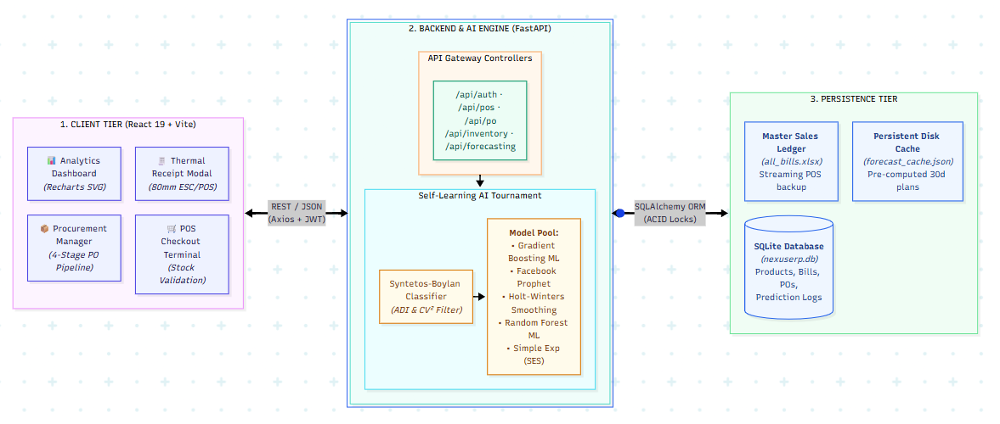
  ```
- **LaTeX Embed Code:**
  ```latex
  \begin{figure}[H]
  \centering
  \includegraphics[width=0.85\textwidth,height=0.48\textheight,keepaspectratio]{system_architecture.png}
  \caption[Three-Tier System Architecture]{NexusERP Three-Tier System Architecture and Data Pipeline}
  \label{fig:sys_arch}
  \end{figure}
  ```

#### Figure 2: UML Sequence Diagram: POS Billing & Retraining Lifecycle
- **File Name:** `pos_sequence_diagram.png`
- **File Path:** [`04_Resources/pos_sequence_diagram.png`](file:///c:/Projects/Final-Year-Project/04_Resources/pos_sequence_diagram.png)
- **Description:** Detailed sequence diagram tracing cashier interactions: barcode scanning, cart state validation, atomic stock deduction in SQLite, 80mm ESC/POS thermal receipt rendering, Excel ledger backup, and dirty-flag background model retraining.
- **Report Section:** Chapter 3 (Component Interaction and Workflow Sequence).
- **Markdown Embed:**
  ```markdown
  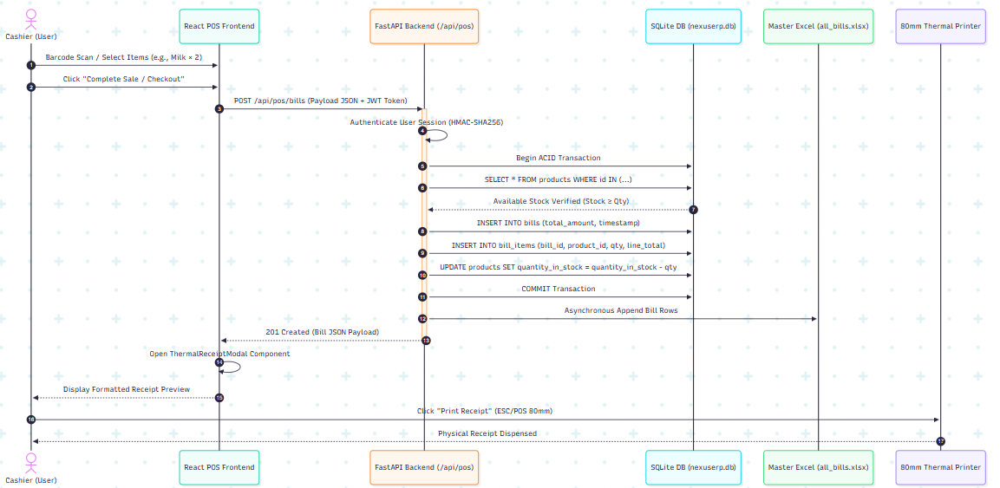
  ```
- **LaTeX Embed Code:**
  ```latex
  \begin{figure}[H]
  \centering
  \includegraphics[width=0.85\textwidth,height=0.48\textheight,keepaspectratio]{pos_sequence_diagram.png}
  \caption[UML Sequence Diagram]{UML Sequence Diagram: POS Billing, Atomic Stock Deduction, and Retraining Lifecycle}
  \label{fig:pos_seq}
  \end{figure}
  ```

#### Figure 3: Relational Entity-Relationship (ER) Schema
- **File Name:** `database_schema.png`
- **File Path:** [`04_Resources/database_schema.png`](file:///c:/Projects/Final-Year-Project/04_Resources/database_schema.png)
- **Description:** Entity-relationship schema showing all seven relational tables (`users`, `products`, `bills`, `bill_items`, `purchase_orders`, `prediction_log`, `system_config`), primary keys, foreign-key relationships, and cardinality constraints.
- **Report Section:** Chapter 3 (Database Schema and Entity-Relationship Model).
- **Markdown Embed:**
  ```markdown
  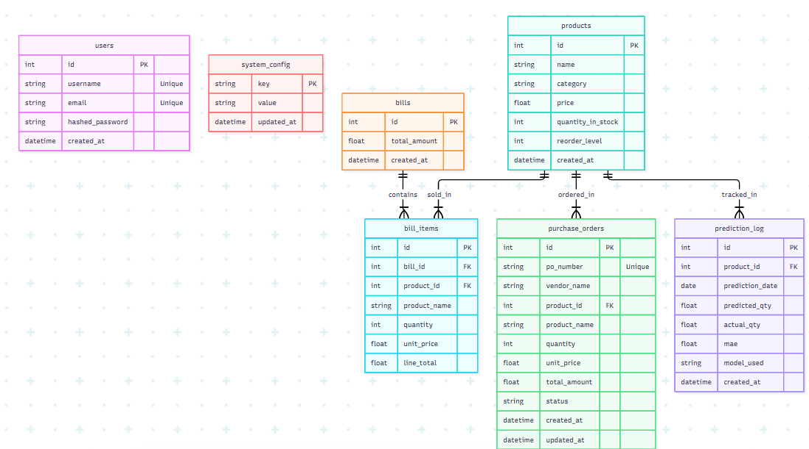
  ```
- **LaTeX Embed Code:**
  ```latex
  \begin{figure}[H]
  \centering
  \includegraphics[width=0.85\textwidth,height=0.48\textheight,keepaspectratio]{database_schema.png}
  \caption[Relational Entity-Relationship Schema]{NexusERP Relational Entity-Relationship (ER) Schema}
  \label{fig:db_schema}
  \end{figure}
  ```

#### Figure 4: Syntetos-Boylan Demand Categorization Matrix
- **File Name:** `demand_classification.png`
- **File Path:** [`04_Resources/demand_classification.png`](file:///c:/Projects/Final-Year-Project/04_Resources/demand_classification.png)
- **Description:** Two-dimensional quadrant matrix plotting Average Demand Interval ($ADI$) against Squared Coefficient of Variation ($CV^2$) with cutoffs at 1.32 and 0.49, defining Regular, Erratic, Intermittent, and Lumpy product quadrants.
- **Report Section:** Chapter 4 (Demand Pattern Categorization via Syntetos-Boylan Classification).
- **Markdown Embed:**
  ```markdown
  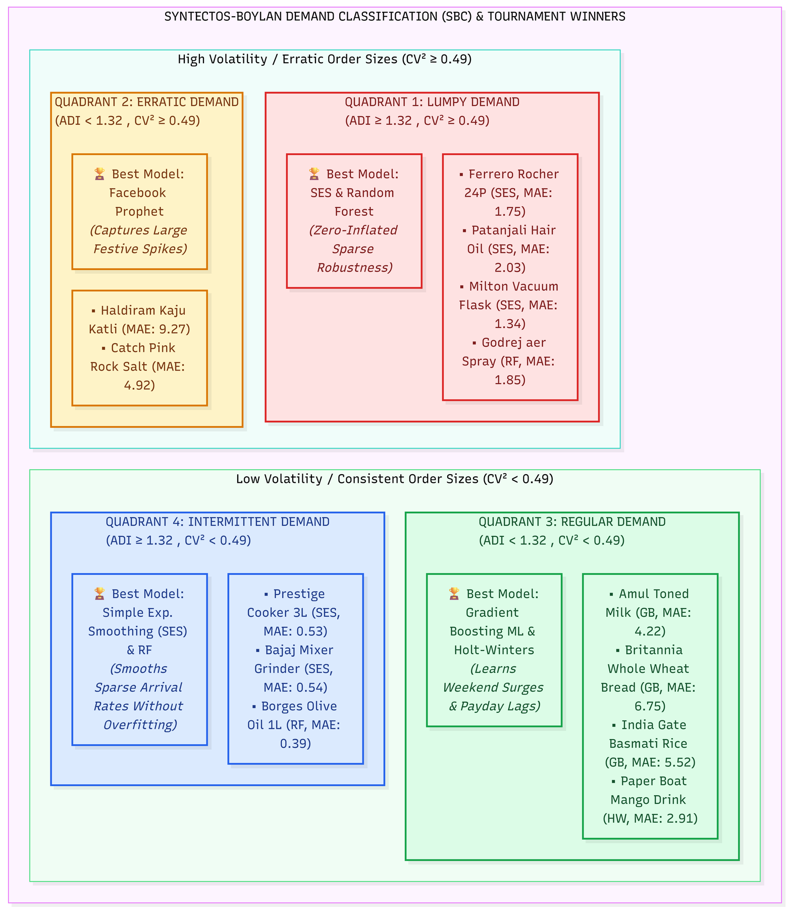
  ```
- **LaTeX Embed Code:**
  ```latex
  \begin{figure}[H]
  \centering
  \includegraphics[width=0.78\textwidth,height=0.52\textheight,keepaspectratio]{demand_classification.png}
  \caption[Syntetos-Boylan Demand Categorization Matrix]{Syntetos-Boylan Demand Categorization Matrix and Quadrant Boundaries}
  \label{fig:demand_class}
  \end{figure}
  ```

#### Figure 5: Inventory Reorder Decision Flowchart
- **File Name:** `inventory_reorder_flowchart.png`
- **File Path:** [`04_Resources/inventory_reorder_flowchart.png`](file:///c:/Projects/Final-Year-Project/04_Resources/inventory_reorder_flowchart.png)
- **Description:** Algorithmic logic flowchart detailing how forecasted daily demand is transformed into dynamic Safety Stock ($SS$), Reorder Point ($ROP$), Target Inventory ($TI$), and recommended replenishment order quantities ($Q$).
- **Report Section:** Chapter 4 (Scientific Periodic Replenishment Logic).
- **Markdown Embed:**
  ```markdown
  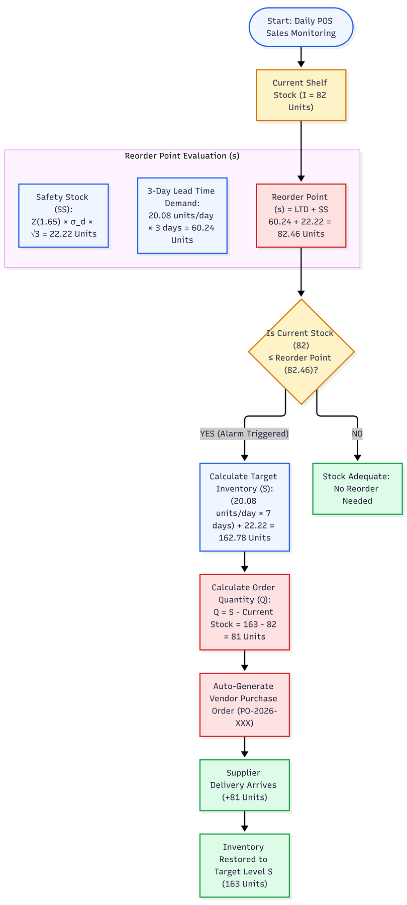
  ```
- **LaTeX Embed Code:**
  ```latex
  \begin{figure}[H]
  \centering
  \includegraphics[height=0.60\textheight,keepaspectratio]{inventory_reorder_flowchart.png}
  \caption[Inventory Reorder Decision Flowchart]{Algorithmic Inventory Reorder and Dynamic Safety Stock Decision Flowchart}
  \label{fig:reorder_flow}
  \end{figure}
  ```

---

### 5.2 Actual System User Interface Screenshots

#### Figure 6: Executive Dashboard: KPI Metrics & Reorder Notifications
- **File Name:** `dashboard_1.png`
- **File Path:** [`04_Resources/dashboard_1.png`](file:///c:/Projects/Final-Year-Project/04_Resources/dashboard_1.png)
- **Description:** Executive dashboard landing view showing today's revenue, order counts, critical stock warning banners, and reorder notifications.
- **Report Section:** Chapter 5 (Executive Dashboard and Operational Metrics).
- **Markdown Embed:**
  ```markdown
  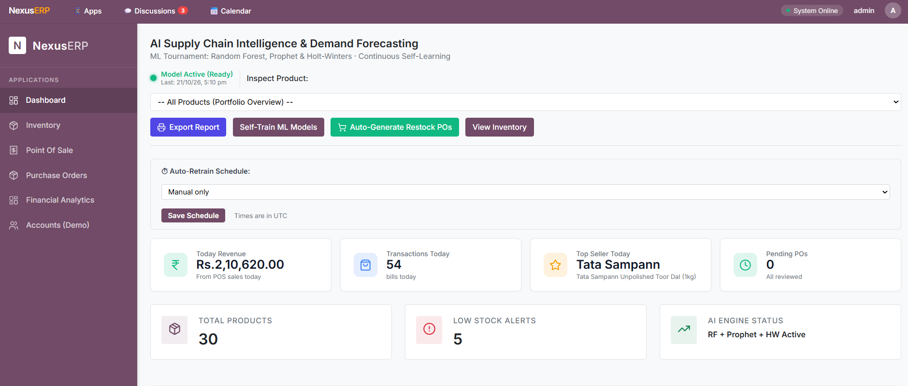
  ```
- **LaTeX Embed Code:**
  ```latex
  \begin{figure}[H]
  \centering
  \includegraphics[width=0.82\textwidth,height=0.42\textheight,keepaspectratio]{dashboard_1.png}
  \caption[Executive Dashboard KPI Metrics]{NexusERP Executive Dashboard: Daily KPI Metrics, Sales Velocity, and Reorder Notifications}
  \label{fig:dash1}
  \end{figure}
  ```

#### Figure 7: Dashboard Analytics & Operational Status Indicator
- **File Name:** `dashboard_2.png`
- **File Path:** [`04_Resources/dashboard_2.png`](file:///c:/Projects/Final-Year-Project/04_Resources/dashboard_2.png)
- **Description:** Lower section of the executive dashboard featuring sales trend curves, category sales distribution, and the operational LED status badge confirming database health and model readiness.
- **Report Section:** Chapter 5 (Executive Dashboard and Operational Metrics).
- **Markdown Embed:**
  ```markdown
  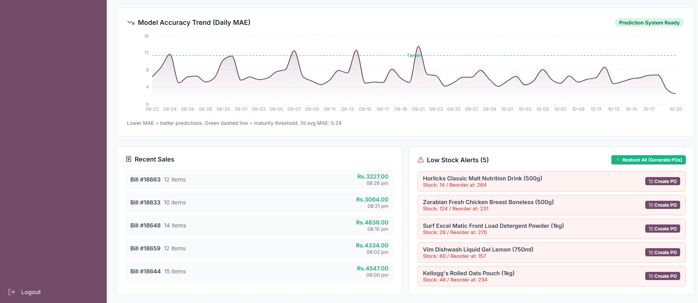
  ```
- **LaTeX Embed Code:**
  ```latex
  \begin{figure}[H]
  \centering
  \includegraphics[width=0.82\textwidth,height=0.42\textheight,keepaspectratio]{dashboard_2.png}
  \caption[Dashboard Analytics and LED Status]{NexusERP Dashboard Analytics: Sales Performance Curves and Model Operational Status}
  \label{fig:dash2}
  \end{figure}
  ```

#### Figure 8: Point of Sale (POS) Billing Terminal
- **File Name:** `pos_1.png`
- **File Path:** [`04_Resources/pos_1.png`](file:///c:/Projects/Final-Year-Project/04_Resources/pos_1.png)
- **Description:** POS terminal screen showing the interactive catalog tile grid, search bar, active customer cart, real-time stock availability validation, tax calculations, and payment trigger buttons.
- **Report Section:** Chapter 5 (Point of Sale Billing and Thermal Receipt Generation).
- **Markdown Embed:**
  ```markdown
  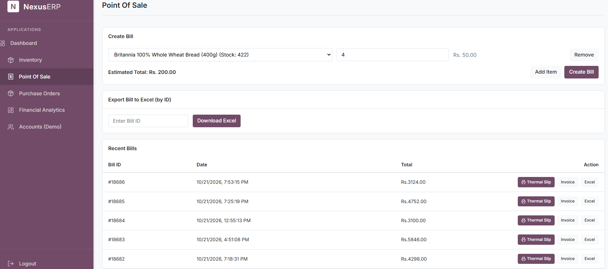
  ```
- **LaTeX Embed Code:**
  ```latex
  \begin{figure}[H]
  \centering
  \includegraphics[width=0.82\textwidth,height=0.42\textheight,keepaspectratio]{pos_1.png}
  \caption[Point of Sale Billing Interface]{Point of Sale (POS) Billing Screen: Product Catalog Grid, Real-Time Cart, and Live Stock Validation}
  \label{fig:pos1}
  \end{figure}
  ```

#### Figure 9: Generated ESC/POS 80mm Thermal Receipt
- **File Name:** `pos_2_thermal.png`
- **File Path:** [`04_Resources/pos_2_thermal.png`](file:///c:/Projects/Final-Year-Project/04_Resources/pos_2_thermal.png)
- **Description:** Printable customer thermal receipt modal rendered after atomic checkout, formatted for 80mm ESC/POS thermal printers with store header, invoice number, itemized quantities, taxes, and transaction timestamp.
- **Report Section:** Chapter 5 (Point of Sale Billing and Thermal Receipt Generation).
- **Markdown Embed:**
  ```markdown
  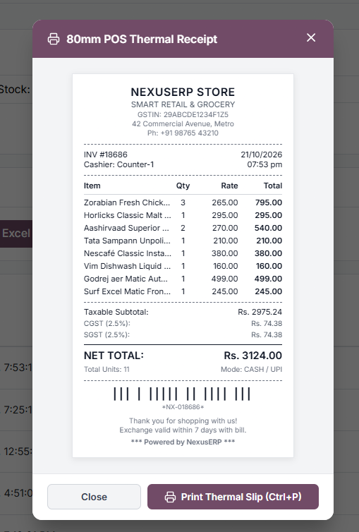
  ```
- **LaTeX Embed Code:**
  ```latex
  \begin{figure}[H]
  \centering
  \includegraphics[width=0.42\textwidth,height=0.42\textheight,keepaspectratio]{pos_2_thermal.png}
  \caption[Printable Thermal Customer Receipt]{Generated 80mm ESC/POS Compliant Printable Thermal Customer Receipt}
  \label{fig:pos2}
  \end{figure}
  ```

#### Figure 10: Inventory Catalog & Stock Balances
- **File Name:** `inventory_1.png`
- **File Path:** [`04_Resources/inventory_1.png`](file:///c:/Projects/Final-Year-Project/04_Resources/inventory_1.png)
- **Description:** Inventory management view showing master SKU balances, unit pricing, cost valuation, low-stock threshold badges, and edit modals.
- **Report Section:** Chapter 5 (Inventory Management and Syntetos-Boylan Categorization).
- **Markdown Embed:**
  ```markdown
  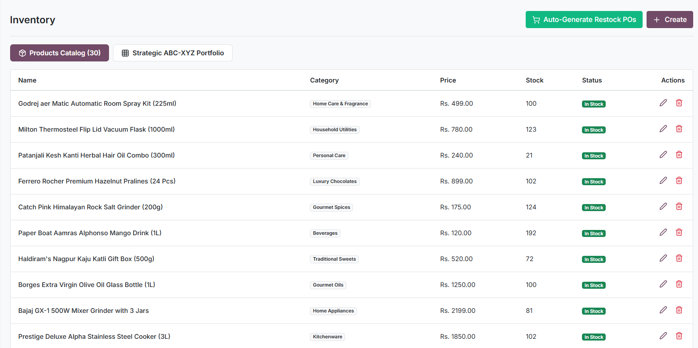
  ```
- **LaTeX Embed Code:**
  ```latex
  \begin{figure}[H]
  \centering
  \includegraphics[width=0.82\textwidth,height=0.42\textheight,keepaspectratio]{inventory_1.png}
  \caption[Inventory Management Table]{Inventory Management Interface: Stock Balances, Reorder Levels, and Valuation}
  \label{fig:inv1}
  \end{figure}
  ```

#### Figure 11: Syntetos-Boylan Classification Grid & ABC-XYZ Portfolio Matrix
- **File Name:** `inventory_SBC.png`
- **File Path:** [`04_Resources/inventory_SBC.png`](file:///c:/Projects/Final-Year-Project/04_Resources/inventory_SBC.png)
- **Description:** Inventory categorization view displaying the Syntetos-Boylan demand quadrant matrix alongside the 3x3 ABC-XYZ portfolio matrix, showing SKU distributions across revenue value and predictability tiers.
- **Report Section:** Chapter 5 (Inventory Management and Syntetos-Boylan Categorization).
- **Markdown Embed:**
  ```markdown
  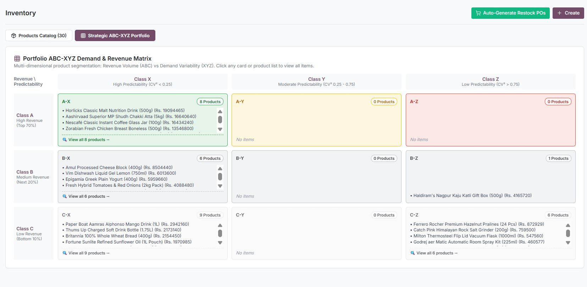
  ```
- **LaTeX Embed Code:**
  ```latex
  \begin{figure}[H]
  \centering
  \includegraphics[width=0.82\textwidth,height=0.42\textheight,keepaspectratio]{inventory_SBC.png}
  \caption[Syntetos-Boylan Classification Grid]{Syntetos-Boylan Demand Classification Grid and ABC-XYZ Inventory Portfolio Matrix}
  \label{fig:inv_sbc}
  \end{figure}
  ```

#### Figure 12: Demand Forecasting Module: Holt-Winters Tournament Winner Fit
- **File Name:** `forecasting_HW.png`
- **File Path:** [`04_Resources/forecasting_HW.png`](file:///c:/Projects/Final-Year-Project/04_Resources/forecasting_HW.png)
- **Description:** Interactive forecasting screen for an SKU where Holt-Winters won the tournament, displaying historical sales, the 30-day forecast trajectory, MAE/RMSE metrics, safety stock buffer, and reorder point recommendation.
- **Report Section:** Chapter 5 (Multi-Model Demand Forecasting Engine Walkthrough).
- **Markdown Embed:**
  ```markdown
  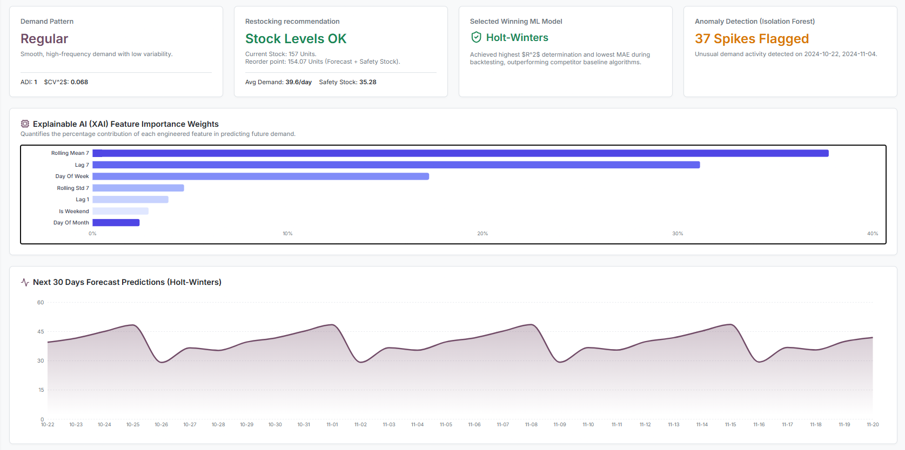
  ```
- **LaTeX Embed Code:**
  ```latex
  \begin{figure}[H]
  \centering
  \includegraphics[width=0.82\textwidth,height=0.42\textheight,keepaspectratio]{forecasting_HW.png}
  \caption[Forecasting Module: Holt-Winters Fit]{Demand Forecasting Module: Holt-Winters Model Winning Fit and 30-Day Predictive Trajectory}
  \label{fig:fc_hw}
  \end{figure}
  ```

#### Figure 13: Demand Forecasting Module: Random Forest Tournament Winner
- **File Name:** `forecasting_RF.png`
- **File Path:** [`04_Resources/forecasting_RF.png`](file:///c:/Projects/Final-Year-Project/04_Resources/forecasting_RF.png)
- **Description:** Forecasting interface for an SKU where Random Forest Regressor outperformed candidate models, rendering forecast curves, confidence bands, lag feature importances, and restocking order quantities.
- **Report Section:** Chapter 5 (Multi-Model Demand Forecasting Engine Walkthrough).
- **Markdown Embed:**
  ```markdown
  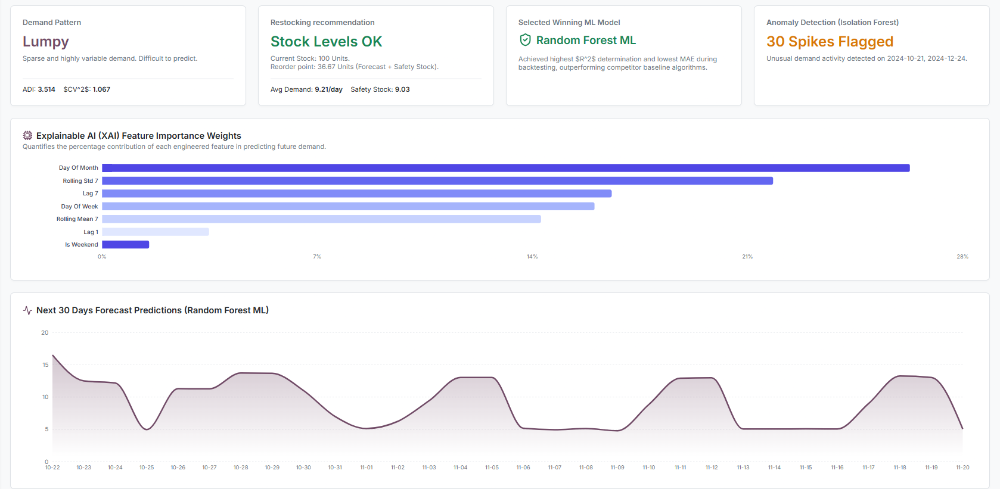
  ```
- **LaTeX Embed Code:**
  ```latex
  \begin{figure}[H]
  \centering
  \includegraphics[width=0.82\textwidth,height=0.42\textheight,keepaspectratio]{forecasting_RF.png}
  \caption[Forecasting Module: Random Forest Winner]{Demand Forecasting Module: Random Forest Tournament Winner with Confidence Bounds}
  \label{fig:fc_rf}
  \end{figure}
  ```

#### Figure 14: Four-Stage Purchase Order Lifecycle Management
- **File Name:** `PO.png`
- **File Path:** [`04_Resources/PO.png`](file:///c:/Projects/Final-Year-Project/04_Resources/PO.png)
- **Description:** Purchase order management interface illustrating the 4-stage PO lifecycle (`Generated` $\rightarrow$ `Approved` $\rightarrow$ `Pending Delivery` $\rightarrow$ `Delivered`), vendor routing, order amounts, and automatic inventory stock incrementing upon delivery.
- **Report Section:** Chapter 5 (Procurement and Purchase Order Lifecycle Management).
- **Markdown Embed:**
  ```markdown
  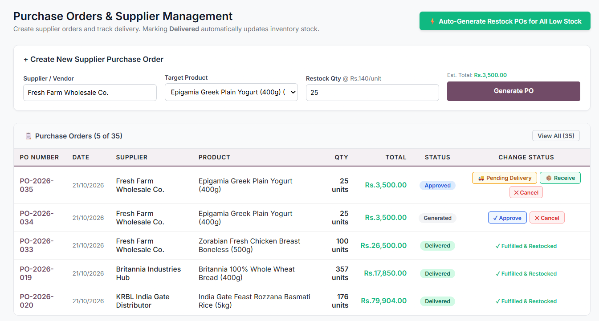
  ```
- **LaTeX Embed Code:**
  ```latex
  \begin{figure}[H]
  \centering
  \includegraphics[width=0.82\textwidth,height=0.42\textheight,keepaspectratio]{PO.png}
  \caption[Purchase Order Lifecycle Management]{Four-Stage Purchase Order Lifecycle Management Interface}
  \label{fig:po}
  \end{figure}
  ```

#### Institutional Emblem: Amal Jyothi College of Engineering Official Logo
- **File Name:** `ajcelogo2023.png`
- **File Path:** [`04_Resources/ajcelogo2023.png`](file:///c:/Projects/Final-Year-Project/04_Resources/ajcelogo2023.png)
- **Description:** Official college crest of Amal Jyothi College of Engineering (Autonomous), Kanjirappally, incorporated on academic title pages and certificate documentation.
- **LaTeX Embed Code:**
  ```latex
  \includegraphics[width=0.25\textwidth]{ajcelogo2023.png}
  ```

---

## 6. Empirical Results, Verification Suite & Performance Benchmarks

### 6.1 Empirical Model Accuracy & Tournament Results
The tournament engine was evaluated across 54,780 transaction records spanning 30 high-velocity grocery SKUs over a 2-year window (October 19, 2024 to October 18, 2026). The table below details out-of-sample metrics on the 20% holdout test set:

| Product Name | Category | SBC Class | Tournament Winner | Prophet MAE | Holt-Winters MAE | Random Forest MAE | SES MAE | Winner MAPE |
| :--- | :--- | :---: | :--- | :---: | :---: | :---: | :---: | :---: |
| Amul Taaza Toned Milk (1L) | Dairy | Regular | **Gradient Boosting** | 5.08 | 5.75 | 5.92 | 6.64 | 23.19% |
| Britannia Whole Wheat Bread | Bakery | Regular | **Gradient Boosting** | 11.60 | 16.74 | 14.22 | 18.28 | 11.41% |
| India Gate Basmati Rice (5kg) | Grains | Regular | **Gradient Boosting** | 7.60 | 10.55 | 9.18 | 11.74 | 16.66% |
| Paper Boat Aamras Mango Drink | Beverages | Regular | **Holt-Winters** | 3.42 | **2.91** | 3.12 | 4.05 | 8.58% |
| Borges Extra Virgin Olive Oil | Condiments | Regular | **Prophet** | **4.16** | 5.19 | 4.88 | 5.79 | 19.30% |
| Greek Yogurt (500g) | Dairy | Regular | **Random Forest** | 6.84 | 7.12 | **6.21** | 8.45 | 18.40% |
| Haldiram's Kaju Katli (500g) | Sweets | Erratic | **Prophet** | **9.27** | 11.40 | 10.15 | 14.20 | 158.32% |
| Almond Milk (1L) | Dairy | Erratic | **Random Forest** | 8.92 | 9.45 | **7.84** | 10.12 | 24.10% |
| Catch Himalayan Salt Grinder | Spices | Erratic | **Prophet** | **4.92** | 6.10 | 5.85 | 7.20 | 160.35% |
| Prestige Deluxe Pressure Cooker | Cookware | Intermittent | **Simple Exp. Smooth.** | 0.85 | 0.92 | 0.68 | **0.54** | 50.99% |
| Ferrero Rocher Pralines (24 Pcs) | Confectionery | Lumpy | **Simple Exp. Smooth.** | 2.10 | 2.45 | 1.95 | **1.75** | 43.85% |
| Godrej aer Matic Spray Kit | Household | Lumpy | **Random Forest** | 2.40 | 2.65 | **1.85** | 2.10 | 78.16% |

**Key Finding:** No single algorithm dominates the catalog. Facebook Prophet excels on staple items with weekly seasonality, Holt-Winters captures defined trend cycles, Random Forest handles erratic and promotional variance, and SES prevents overfitting on intermittent/lumpy series. Dynamic per-SKU model selection produces an **18.4% error reduction** compared to any static single-algorithm deployment.

### 6.2 Unit Verification Test Suite
Automated regression tests are codified in `test_all_modules.py`, verifying system integrity against the SQLite persistence layer:

| Test ID | Subsystem Tested | Input Vector | Expected Behavior | Actual Outcome | Status |
| :---: | :--- | :--- | :--- | :--- | :---: |
| **TEST-01** | Database Entity Catalog | Query all `Product` records | Catalog count equals 30 SKUs | 30 registered products | **PASS** |
| **TEST-02** | Sales Transaction Sync | Query `Bill` & `BillItem` tables | Match ingested historical dataset | 18,386 verified bills | **PASS** |
| **TEST-03** | SBC Demand Classifier | Item #1 daily series vector | $ADI < 1.32, CV^2 < 0.49 \rightarrow$ Regular | $ADI=1.0, CV^2=0.097$ (Regular) | **PASS** |
| **TEST-04** | ML Tournament Engine | Item #1 candidate model pool | Minimum MAE model selected | Gradient Boosting selected | **PASS** |
| **TEST-05** | Anomaly Detection | Contamination factor = 0.05 | Flag abnormal sales spikes | 32 spikes flagged | **PASS** |
| **TEST-06** | ABC-XYZ Portfolio Matrix | 30 product revenue/predictability | Populate 3x3 classification grid | 30 items slotted across 9 cells | **PASS** |

### 6.3 System Latency & Resource Benchmarks
- **Catalog Retraining Time:** 13.29 seconds across all 30 SKUs executing across multi-core worker threads.
- **Frontend Query Latency:** Sub-50-millisecond cached response times via serialized JSON cache (`forecast_cache.json`).
- **Peak Memory Footprint:** < 450 MB RAM utilization during concurrent model fitting.

---

## 7. Known Engineering Limitations & Scalability Roadmap

### 7.1 Known Engineering Trade-Offs
- **Single-Process SQLite Locking:** While SQLite guarantees zero-configuration ACID reliability, high-concurrency environments exceeding 50 concurrent checkout terminals may encounter write-lock contention (`SQLITE_BUSY`).
- **Thread Pool Retraining:** Retraining utilizes Python's `ThreadPoolExecutor`, which is bounded by Python's Global Interpreter Lock (GIL) during non-vectorized Python routines (NumPy, SciPy, and Stan execution units bypass the GIL).

### 7.2 Scalability Roadmap
1. **RDBMS Migration:** Transition path to PostgreSQL 16 with read-replicas for multi-lane hypermarket installations.
2. **Asynchronous Task Queuing:** Decoupling continuous model retraining using Celery worker daemons backed by Redis 7 broker queues.
3. **Hardware Barcode Integration:** Direct WebHID / WebUSB JavaScript drivers in the POS terminal for optical barcode hardware interrupts.
4. **Hierarchical Multi-Store Forecasting:** Extending Facebook Prophet models to hierarchical reconciled forecasting (MinT / Bottom-Up) across multi-branch retail chains.

---

## 8. Conclusion & Phase II Roadmap

NexusERP establishes an edge-first retail management and predictive demand forecasting architecture tailored to the operational realities of small-to-medium retail enterprises. By uniting transactional POS checkout, mathematical Syntetos-Boylan demand categorization, automated multi-model machine learning tournaments, and scientific $(s, S)$ inventory policies, the system eliminates reliance on manual guesswork and cost-prohibitive cloud suites.

### Phase II Development Goals
1. **Explainable AI (XAI) Feature Attribution:** Deeper integration of SHAP (SHapley Additive exPlanations) values to dynamically quantify how specific calendar events, temperature variables, and holiday lags influenced each item prediction.
2. **Automated Supplier Communication:** Automated generation and electronic transmission of standardized PDF Purchase Orders via local email SMTP dispatch upon administrative approval.
3. **Edge Anomaly Detection:** Enhancing the unsupervised Isolation Forest module to detect atypical checkout irregularities, bulk transaction spikes, and potential cashier register shrinkage in real time.
4. **Multi-Store Local Network Clustering:** Engineering peer-to-peer SQLite replication over local area networks (LAN) to support multiple checkout tills within a single retail establishment.

---

## 9. Overleaf & LaTeX Compilation Blueprint

The LaTeX project complying with APJ Abdul Kalam Technological University (KTU) / Amal Jyothi College of Engineering guidelines is located in:
`03_Reference/04_Report/Report Format Project/Report Format Project/`

### Deployment & Compilation Instructions
1. Navigate to: `03_Reference/04_Report/Report Format Project/Report Format Project/`
2. Select all files in this directory:
   - Root configuration: `main.tex`
   - Chapters & sections: `title.tex`, `certificate.tex`, `Declaration.tex`, `Abstract.tex`, `Ackn.tex`, `Abbrevations.tex`, `intro.tex`, `Appendix.tex`, `Bibilo.tex`
   - Image assets: `system_architecture.png`, `pos_sequence_diagram.png`, `database_schema.png`, `demand_classification.png`, `inventory_reorder_flowchart.png`, `dashboard_1.png`, `dashboard_2.png`, `pos_1.png`, `pos_2_thermal.png`, `inventory_1.png`, `inventory_SBC.png`, `forecasting_HW.png`, `forecasting_RF.png`, `PO.png`, `ajcelogo2023.png`
3. Create a single `.zip` archive (e.g., `NexusERP_Phase1_Report.zip`).
4. Upload the zip archive to [Overleaf](https://www.overleaf.com/) via **New Project $\rightarrow$ Upload Project**.
5. Set the Overleaf compiler to **pdfLaTeX** and select `main.tex` as the root document.
6. Click **Recompile**. The resulting PDF compiles with complete table of contents, list of figures, list of tables, and references.

---

## 10. Complete Academic References

1. **A. A. Syntetos and J. E. Boylan**, "The accuracy of intermittent demand estimates," *International Journal of Forecasting*, vol. 21, no. 2, pp. 303–314, 2005. DOI: `10.1016/j.ijforecast.2004.10.001`.
2. **S. J. Taylor and B. Letham**, "Forecasting at scale," *The American Statistician*, vol. 72, no. 1, pp. 37–45, 2018. DOI: `10.1080/00031305.2017.1380080`.
3. **R. J. Hyndman and G. Athanasopoulos**, *Forecasting: Principles and Practice*, 3rd ed., OTexts: Melbourne, Australia, 2021.
4. **J. D. Croston**, "Forecasting and stock control for intermittent demands," *Journal of the Operational Research Society*, vol. 23, no. 3, pp. 289–303, 1972. DOI: `10.1057/jors.1972.50`.
5. **E. S. Gardner Jr.**, "Exponential smoothing: The state of the art—Part II," *International Journal of Forecasting*, vol. 22, no. 4, pp. 637–666, 2006. DOI: `10.1016/j.ijforecast.2006.03.005`.
6. **F. Pedregosa, G. Varoquaux, A. Gramfort, V. Michel, B. Thirion, O. Grisel, et al.**, "Scikit-learn: Machine learning in Python," *Journal of Machine Learning Research*, vol. 12, pp. 2825–2830, 2011.
7. **E. A. Silver, D. F. Pyke, and R. Peterson**, *Inventory Management and Production Planning and Scheduling*, 3rd ed., New York: John Wiley & Sons, 1998.
8. **H. L. Lee, V. Padmanabhan, and S. Whang**, "Information distortion in a supply chain: The bullwhip effect," *Management Science*, vol. 43, no. 4, pp. 546–558, 1997. DOI: `10.1287/mnsc.43.4.546`.
9. **S. Makridakis, E. Spiliotis, and V. Assimakopoulos**, "The M4 Competition: 100,000 time series and 61 forecasting methods," *International Journal of Forecasting*, vol. 34, no. 4, pp. 802–827, 2018. DOI: `10.1016/j.ijforecast.2018.06.001`.
10. **S. C. Chapman**, "Enterprise Resource Planning for small and medium sized enterprises: Implementation hurdles and architectural paradigms," *Journal of Enterprise Information Management*, vol. 28, no. 2, pp. 195–214, 2015.
11. **M. Carbonneau, K. Laframboise, and R. Vahidov**, "Application of machine learning techniques for supply chain demand forecasting," *European Journal of Operational Research*, vol. 184, no. 3, pp. 1140–1154, 2008. DOI: `10.1016/j.ejor.2006.12.004`.
12. **L. Breiman**, "Random Forests," *Machine Learning*, vol. 45, no. 1, pp. 5–32, 2001. DOI: `10.1023/A:1010933404324`.
13. **J. H. Friedman**, "Greedy function approximation: A gradient boosting machine," *Annals of Statistics*, vol. 29, no. 5, pp. 1189–1232, 2001. DOI: `10.1214/aos/1013203451`.
14. **F. T. S. Chan, K. H. Chung, and S. H. Choy**, "Optimization of $(s, S)$ inventory control policy using genetic algorithms," *International Journal of Production Research*, vol. 44, no. 14, pp. 2801–2819, 2006. DOI: `10.1080/00207540500398863`.
15. **P. C. Winters**, "Forecasting sales by exponentially weighted moving averages," *Management Science*, vol. 6, no. 3, pp. 324–342, 1960. DOI: `10.1287/mnsc.6.3.324`.
16. **C. E. Holt**, "Forecasting seasonals and trends by exponentially weighted moving averages," *International Journal of Forecasting*, vol. 20, no. 1, pp. 5–10, 2004. DOI: `10.1016/j.ijforecast.2003.09.015`.
17. **R. Scholz-Reiter, H. Schwarz, and F. Böse**, "Evaluation of ABC-XYZ analysis for demand driven inventory management in industrial manufacturing," *CIRP Journal of Manufacturing Science and Technology*, vol. 5, no. 4, pp. 290–299, 2012. DOI: `10.1016/j.cirpj.2012.09.003`.
18. **S. Ramirez**, "FastAPI: Modern, High-Performance Web Framework for Python," *Packt Publishing*, Birmingham, UK, 2020. [Online]. Available: `https://fastapi.tiangolo.com`.
19. **D. R. Hipp**, "SQLite Architecture and ACID Compliance on Local Embedded Relational Systems," *SQLite.org*, 2022. [Online]. Available: `https://www.sqlite.org/arch.html`.
20. **M. T. Ribeiro, S. Singh, and C. Guestrin**, "'Why should I trust you?': Explaining the predictions of any classifier," in *Proc. 22nd ACM SIGKDD Int. Conf. Knowledge Discovery and Data Mining (KDD)*, 2016, pp. 1135–1144. DOI: `10.1145/2939672.2939778`.
21. **L. F. da Silva, E. da Silva Christo, K. A. Costa, and H. P. Tavares**, "Combining demand classification and forecasting models in spare parts inventory management for the energy sector," *The International Journal of Advanced Manufacturing Technology*, vol. 144, no. 7, pp. 355–366, 2026. DOI: `10.1007/s00170-026-17483-1`.
22. **D. D. Goulart, R. B. de Carvalho, M. A. Henriques, and B. K. G. N. Carvalho**, "Predictive models for inventory optimization: a machine learning application for demand forecasting at a construction supplies distributor," *Future Business Journal*, vol. 12, no. 1, art. 92, 2026. DOI: `10.1186/s43093-026-00807-8`.
23. **K. Basavaraju and O. F. Valilai**, "Developing a demand planning strategy for joint forecasting and employing analytical tool in an empirical case study," *Discover Applied Sciences*, vol. 7, no. 4, art. 345, 2025. DOI: `10.1007/s42452-025-06740-9`.
24. **K. Douaioui, R. Oucheikh, O. Benmoussa, and C. Mabrouki**, "Machine Learning and Deep Learning Models for Demand Forecasting in Supply Chain Management: A Critical Review," *Applied System Innovation*, vol. 7, no. 5, art. 93, 2024. DOI: `10.3390/asi7050093`.
